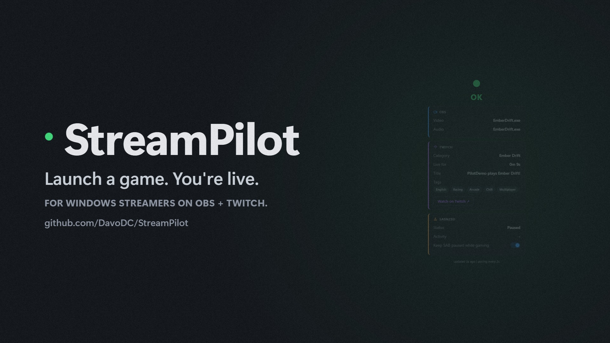

# StreamPilot

Launch a game and you are live. One click starts StreamPilot, and from then on it runs your whole stream: it opens OBS, points it at your game, sets your Twitch category, title and tags, starts the stream, and keeps your downloads from choking your upload. Close the game and it ends the stream and tidies up. You never touch OBS or Twitch settings again.

*Click to watch the 20 second video.*

## Why you will want it

- **One click, then forget it.** Start it once; every game after that is automatic.
- **Everything handled for you.** Right window captured, right Twitch category, a fresh title and tags for each game, stream started, SABnzbd paused so downloads never slow your stream.
- **It keeps fixing itself.** Every couple of seconds it checks that OBS is connected, the right window is captured, the stream is up and downloads are still paused, and puts anything that drifted back.
- **Know it is all good at a glance.** A live dashboard on your second screen shows OBS, Twitch and SABnzbd in one place, and the browser tab title and icon change colour with the status.
- **Safe to stream.** It never broadcasts a non-game window, and private audio can never reach the stream.
- **Light and local.** It runs entirely on your own PC, with no cloud service of its own and no heavy dependencies.

## Dashboard

## How it works

1. Run `scripts\run.bat`. It starts StreamPilot, launches OBS if needed, and opens the live dashboard in your browser.
2. Launch your game. StreamPilot sets the OBS capture, the Twitch category, title and tags, and starts the stream.
3. It pauses SABnzbd for the session so downloads do not hurt your connection mid-game.
4. Close the game. The stream ends and SABnzbd resumes. Each game gets its own stream, so the next game starts a fresh one.
5. Done for the night? Click **Quit** on the dashboard and confirm. It stops the stream, resumes SABnzbd and closes itself. `run.bat` has no console window, so this is the only way to shut it down other than Task Manager.

## Private audio can never reach the stream

Anything you are not actively playing stays off the stream, every second you are live, without you having to mute it, check a source list, or trust a setup from six months ago.

StreamPilot owns OBS's "Application Audio Output Capture" source directly: when your game launches, its exe becomes the *only* entry in that source's capture list, and everything else is removed. Every heartbeat while you stream, it re-checks the live list against that one allowed exe. If anything unexpected appears, it force-stops the stream immediately instead of just logging a warning. There is no allow-list to maintain and no wide list of every game you have ever added sitting in the capture source waiting to leak: exactly one exe, the one you are playing now.

---

## Prerequisites

- A Twitch account with **Two-Factor Authentication (2FA) enabled** - required by Twitch when authorising StreamPilot to manage your channel. Enable it at [twitch.tv/settings/security](https://www.twitch.tv/settings/security) under "Two-Factor Authentication"
- [Python 3.8+](https://www.python.org/downloads/)
- [OBS Studio](https://obsproject.com/download)

## Get started

One-time setup takes five short steps: see [docs/SETUP.md](docs/SETUP.md).

---

## Usage

Double-click `scripts\run.bat`. Then just launch your game - everything else is automatic.